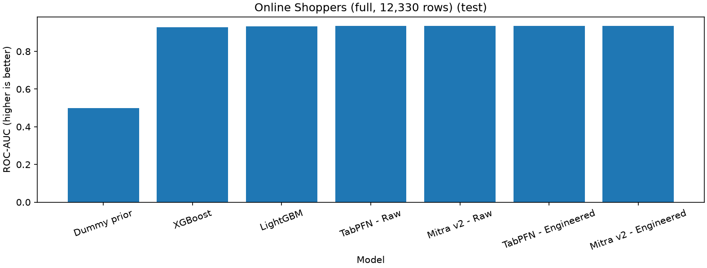
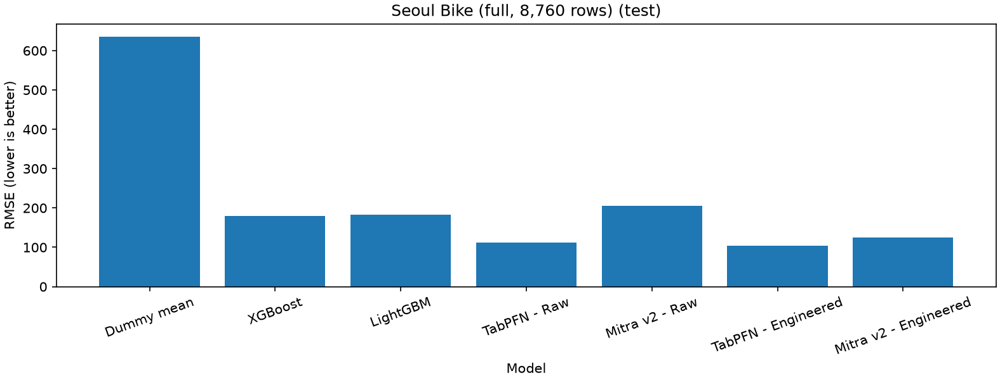
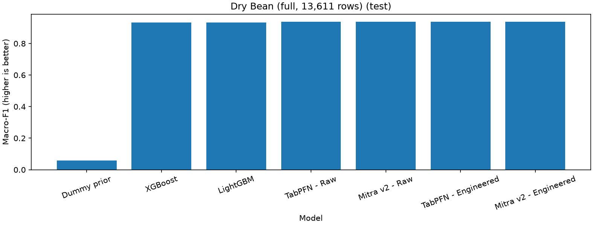

# Tabular benchmark results

Compare frozen Mitra v2 and TabPFN-3.5-Fast with validation-tuned XGBoost and LightGBM on three public tabular datasets. The tables below are generated from saved full-data predictions and metrics; synthetic demos and 500-row smoke profiles are excluded.

## Data and methodology

| Dataset | Task | Rows | Source features | Train / validation / test |
| --- | --- | ---: | ---: | --- |
| [Online Shoppers](https://archive.ics.uci.edu/dataset/468/online+shoppers+purchasing+intention+dataset) | binary | 12,330 | 17 | 7,398 / 2,466 / 2,466 |
| [Seoul Bike](https://archive.ics.uci.edu/dataset/560/seoul+bike+sharing+demand) | regression | 8,760 | 13 | 5,256 / 1,752 / 1,752 |
| [Dry Bean](https://archive.ics.uci.edu/dataset/602/dry+bean+dataset) | multiclass | 13,611 | 16 | 8,166 / 2,722 / 2,723 |

All datasets are CC BY 4.0; author/citation details, source URLs, and archive/member hashes are pinned in the [dataset manifests](../datasets/). Targets are Revenue (positive=True), Rented Bike Count, and Class, respectively, and are excluded from predictors. Every released row is retained.

Every model uses the same seed-42 60/20/20 split for its dataset, stratified for classification. Seoul Bike uses the user-confirmed random-split retrospective tabular prediction protocol with observed weather. Exploration and all learned preprocessing use training rows only. Validation selects classical settings; test predictions are produced for each predeclared recipe after that recipe's selection. Earlier test results do not alter later recipes. There is no train-plus-validation refit, automatic subsampling, resampling, threshold search, or target transformation.

Zero-shot here means frozen pretrained weights with labeled training examples supplied as inference context; it does not mean inference without labels or without preprocessing. Foundation models use native train-only preprocessing, no fine-tuning or validation search, TabPFN's auto ensemble, and one Mitra estimator. Mitra regression uses the distributional head's softmax-weighted bin-center mean. [Checkpoint identities](../checkpoints/manifest.json) pin the exact task-specific revisions.

## Features and classical tuning

Raw foundation settings retain source features with only model-required formatting. Seoul Date is parsed as day/month/year and represented as days since the fixed Unix epoch. Engineered settings retain originals and add:

| Dataset | Fixed row-local features |
| --- | --- |
| Online Shoppers | Total pages, total duration, seconds/page, product-page fraction, exit-minus-bounce rate; zero-page ratios become zero |
| Seoul Bike | Hour sine/cosine, weekday, month, weekend indicator, day-of-year sine/cosine |
| Dry Bean | Natural logs of area, perimeter, major-axis length, and minor-axis length |

Both classical models use engineered features with train-only imputation, scaling, and categorical encoding where applicable. Each grid has four candidates with 80 trees: XGBoost learning_rate ∈ {0.05, 0.1}, max_depth ∈ {3, 6}; LightGBM learning_rate ∈ {0.05, 0.1}, num_leaves ∈ {7, 15}. Selection maximizes validation ROC-AUC/macro-F1 or minimizes validation RMSE, with first-candidate tie-breaking. Selected parameters, every trial's validation scores, and preprocessing recipes are saved in each results.json.

## Measured test results

Values are rounded to four decimals here; JSON/CSV artifacts retain the recorded precision. ROC-AUC and macro-F1 are primary for classification (higher is better). RMSE is primary for regression (lower is better); RMSE and MAE use bikes/hour. Average precision is not trapezoidal PR-curve area. Binary F1/precision/recall use model-default decisions. Dry Bean also exports per-class results and confusion matrices.

### Online Shoppers

| Model | ROC-AUC | Average precision | F1 | Precision | Recall | Accuracy |
| --- | ---: | ---: | ---: | ---: | ---: | ---: |
| Dummy prior | 0.5000 | 0.1549 | 0.0000 | 0.0000 | 0.0000 | 0.8451 |
| XGBoost | 0.9294 | 0.7341 | 0.6515 | 0.7134 | 0.5995 | 0.9006 |
| LightGBM | 0.9321 | 0.7396 | 0.6420 | 0.7019 | 0.5916 | 0.8978 |
| TabPFN - Raw | 0.9350 | 0.7593 | 0.6695 | 0.7382 | 0.6126 | 0.9063 |
| Mitra v2 - Raw | 0.9366 | 0.7543 | 0.6341 | 0.7304 | 0.5602 | 0.8998 |
| TabPFN - Engineered | 0.9348 | 0.7570 | 0.6705 | 0.7405 | 0.6126 | 0.9067 |
| Mitra v2 - Engineered | 0.9353 | 0.7514 | 0.6489 | 0.7474 | 0.5733 | 0.9039 |

Best observed test ROC-AUC: **Mitra v2 - Raw**, **0.9366**. This is a descriptive ranking on this split.

Evaluated: 7/7. [Executed notebook](../notebooks/01_binary_classification.ipynb) · [CSV](online-shoppers/full/metrics.csv) · [Predictions and provenance](online-shoppers/full/results.json) · [Reproduction guide](../docs/online-shoppers.md)



Results artifact SHA-256: `3baf6db85552e04375ed6436c02c7cfd787468fa46937330aa5c6508a471c991`.

### Seoul Bike

| Model | RMSE | MAE | R² |
| --- | ---: | ---: | ---: |
| Dummy mean | 636.0166 | 512.7802 | -0.0001 |
| XGBoost | 179.4589 | 104.3465 | 0.9204 |
| LightGBM | 182.8140 | 112.1801 | 0.9174 |
| TabPFN - Raw | 111.7418 | 59.8627 | 0.9691 |
| Mitra v2 - Raw | 205.1263 | 112.9967 | 0.8960 |
| TabPFN - Engineered | 104.7439 | 48.1243 | 0.9729 |
| Mitra v2 - Engineered | 125.4689 | 55.7599 | 0.9611 |

Best observed test RMSE: **TabPFN - Engineered**, **104.7439**. This is a descriptive ranking on this split.

Evaluated: 7/7. [Executed notebook](../notebooks/02_regression.ipynb) · [CSV](seoul-bike/full/metrics.csv) · [Predictions and provenance](seoul-bike/full/results.json) · [Reproduction guide](../docs/seoul-bike.md)



Results artifact SHA-256: `987ade51c8d5693c26c1f2e8e08f09f27f73a7a418a67e81f03d90f6fb44d08c`.

### Dry Bean

| Model | Macro-F1 | Weighted-F1 | Accuracy |
| --- | ---: | ---: | ---: |
| Dummy prior | 0.0591 | 0.1079 | 0.2607 |
| XGBoost | 0.9334 | 0.9202 | 0.9203 |
| LightGBM | 0.9336 | 0.9200 | 0.9203 |
| TabPFN - Raw | 0.9390 | 0.9264 | 0.9266 |
| Mitra v2 - Raw | 0.9370 | 0.9239 | 0.9243 |
| TabPFN - Engineered | 0.9381 | 0.9250 | 0.9251 |
| Mitra v2 - Engineered | 0.9372 | 0.9246 | 0.9251 |

Best observed test Macro-F1: **TabPFN - Raw**, **0.9390**. This is a descriptive ranking on this split.

Evaluated: 7/7. [Executed notebook](../notebooks/03_multiclass_classification.ipynb) · [CSV](dry-bean/full/metrics.csv) · [Predictions and provenance](dry-bean/full/results.json) · [Reproduction guide](../docs/dry-bean.md)



Results artifact SHA-256: `895e93c372cbd87239c27e00656cf03fcd1133ab21beda3669df6e3736d17265`.

## Runtime and environment

Elapsed seconds below include worker startup, imports/loading, classical search where applicable, and validation/test prediction. They are one-run wall times, not isolated training or inference benchmarks. Classical models ran on CPU with one model thread; foundation models ran on the recorded GPU. Each model used a separate worker with a 300-second budget and no silent fallback.

| Model | Online Shoppers (s) | Seoul Bike (s) | Dry Bean (s) |
| --- | ---: | ---: | ---: |
| Dummy prior / mean | 2.8 | 6.1 | 3.7 |
| XGBoost | 4.0 | 3.9 | 5.3 |
| LightGBM | 3.2 | 3.0 | 4.4 |
| TabPFN - Raw | 19.4 | 14.4 | 19.5 |
| Mitra v2 - Raw | 168.6 | 38.4 | 192.8 |
| TabPFN - Engineered | 19.9 | 11.9 | 21.3 |
| Mitra v2 - Engineered | 206.6 | 49.3 | 230.1 |

| Environment | Online Shoppers | Seoul Bike | Dry Bean |
| --- | --- | --- | --- |
| python | 3.12.3 | 3.12.3 | 3.12.3 |
| numpy | 2.5.4 | 2.5.4 | 2.5.4 |
| pandas | 2.3.3 | 2.3.3 | 2.3.3 |
| scikit-learn | 1.9.1 | 1.9.1 | 1.9.1 |
| xgboost | 3.4.1 | 3.4.1 | 3.4.1 |
| lightgbm | 4.7.0 | 4.7.0 | 4.7.0 |
| torch | 2.13.0+cu132 | 2.13.0+cu132 | 2.13.0+cu132 |
| tabpfn | 9.0.0 | 9.0.0 | 9.0.0 |
| autogluon.tabular | 1.6.3 | 1.6.3 | 1.6.3 |

Recorded GPU: NVIDIA GeForce RTX 3050 6GB Laptop GPU. Mitra used bfloat16 autocast on this GPU while checkpoint parameters remained frozen. Full datasets exceed TabPFN's default CPU row limit; tiny CPU smoke checks do not establish full-data feasibility. A matching Python/package environment and GPU precision can still produce small cross-device numerical differences.

## Interpretation and limitations

Foundation-model settings are competitive with these practical, small-grid tree baselines on the recorded splits. Feature engineering has dataset-dependent effects; compare the separately labeled raw and engineered rows. The tables do not establish a universally superior family or compare against an exhaustive classical search. Metrics from different tasks must not be averaged into a common score.

These are single-split descriptive results without repeated-seed uncertainty or significance tests. Online Shoppers retains 125 identical records and session-derived PageValues; availability at a specific live prediction time is not verified. Seoul Bike includes all 295 non-functioning hours, observed weather, and temporal neighbors across random partitions; this is not future forecasting. Dry Bean retains 68 identical records and uses released image-derived measurements, without evaluating image acquisition or segmentation. Source identifiers are unavailable for further group/independence checks. Unknown overlap with foundation-model pretraining data is not audited. Conclusions apply to these datasets, splits, and settings.

## Reproduction and verification

Follow the [README setup and notebook commands](../README.md). Dataset manifests and [checkpoint revisions](../checkpoints/manifest.json) pin inputs; full JSON records source fingerprints, row/split positions, predictions, selected settings, and runtime provenance. Smoke profiles and synthetic demos write separate directories and are not included here.

```bash
.venv/bin/python -m unittest discover -s tests -v
.venv/bin/python scripts/build_report.py
.venv/bin/python scripts/build_report.py --check
```

The report builder requires completed notebooks, full source-row coverage, matching manifests/split/CSV artifacts, and metrics consistent with saved validation/test predictions (allowing float32 regression rounding). It does not load model weights, download data, or refit models. `--check` verifies that this report is current without modifying it. Unevaluated models retain explicit reasons and no substitute scores.
